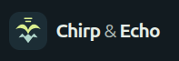
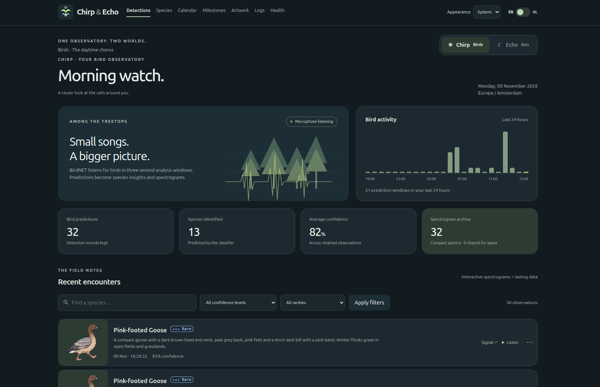
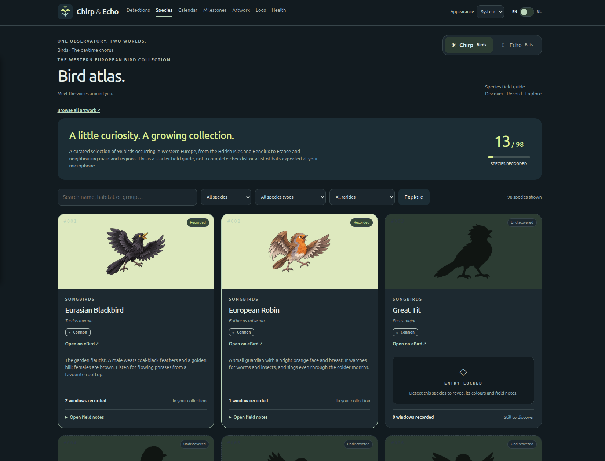
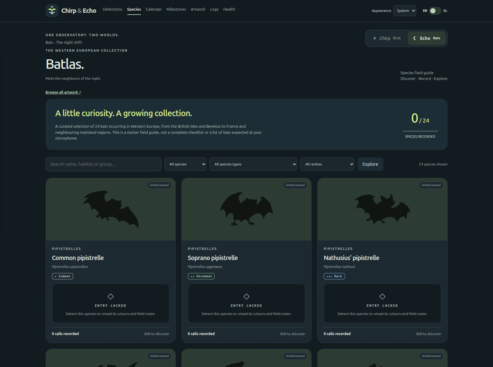

**Birds by song. Bats by echo. A wildlife guestbook for my home.**

I built Chirp & Echo to discover the birds and bats in and around my house.
Who is singing outside the window? Who flies past after sunset?
One Raspberry Pi listens; the neighbours supply the soundtrack.

## One observatory. Two worlds. 🎙️

**Chirp** recognises birdsong with BirdNET 2.4. **Echo** searches for bat calls
with BatDetect2. My Vleermic captures at 384 kHz; Chirp gets a separate 48 kHz
stream. Both listeners run continuously, whichever page is open.

Saved predictions become a collection of species, recordings, timestamps,
confidence scores and interactive spectrograms. Identification runs locally.
Predictions are clues to review, rather than confirmed sightings or animal counts.

## Find your way around

| Tab | What you can explore |
| --- | --- |
| **Detections** | Recent encounters with species portraits, confidence, timestamps, playback and spectrograms. |
| **Species** | The Bird Atlas and Batlas: discover species, unlock artwork and read field notes. |
| **Calendar** | A shared bird-and-bat diary with daily activity, encounters and weekly reports. |
| **Milestones** | Illustrated achievements, collecting sets and checklists for birds and bats. |
| **Artwork** | The full illustration gallery, with a Chirp/Echo selector and species search. |
| **Logs** | Follow the selected bird or bat pipeline through capture and classification. |
| **Health** | Check both pipelines, their archives and available storage. |

Chirp and Echo share a consistent introduction and navigation. Calendar,
Milestones and Health bring both worlds together without a bird/bat selector.
The interface supports **English and Dutch**, with **light, dark and system**
appearance options. 

The switch options **Chirp** and **Echo** makes the switch between birds and bats.

Open an encounter's **Signal** to explore its spectrogram, recording time and
frequency. Use **Listen** to replay the saved WAV while it remains available.

The **Artwork** gallery reveals the whole illustration collection for browsing,
including undiscovered species. Switch between **Chirp · Birds** and
**Echo · Bats**, search by species name, and open any image at full size.

## A Pokédex outside the window 

I borrowed Pokémon's **Pokédex** idea: discover a species and unlock its card.
No tall grass required, just a microphone and some chatty neighbours.

- **99 birds and 24 bats** in the starter field guides. See the
  [full roster, model support and rarity tiers](SPECIES.md).
- **123 individual illustrations** with lively Pokémon-inspired artwork on
  transparent backgrounds with thin outlines. Undiscovered cards use matching silhouettes.
- **Field notes to unlock:** a retained prediction reveals a species' colours
  and description. Bird cards link to eBird; bat cards link to species references.
- **Rarity stars:** Common, Uncommon, Rare, Epic and Legendary are collection-game
  tiers, rather than measures of local abundance or conservation status.
- Both an atlas for birds and bats: Birdatlas - Batatlas.

  
  

BirdNET can also recognise birds outside the starter catalogue. Qualifying bird
predictions are saved and marked **“Not in catalogue — needs to be added.”**
The Bird Atlas lists them under **“Birds to add to the catalogue”**, ready for
identification review and a future atlas entry. They do not automatically unlock
or create a catalogue card. Non-bird model labels are excluded.

**I am updating the species list frequently as new species are discovered.**

The **Species type** filter uses the same 16 bird and five bat browsing sections
as the **Artwork** gallery, alphabetised in the selected language. Each species
keeps its native type on its card: a starling is a **Starling**, shown in the
**Crows, jays and starlings** browsing section. See [SPECIES.md](SPECIES.md) for
all sections and counts. Combine the filter with search, rarity and collection
status. Milestone collecting sets remain independent of browsing sections.

## A diary from dawn to dusk and little discoveries, illustrated milestones 

The **Calendar** combines both archives into one listening diary. Browse weeks
with the arrows or date picker, then select a day from the compact week strip.

The **Milestones** page brings together **37 illustrated achievements**. Cards
use the same colourful bird and bat portraits as the collection, with progress
bars and expandable checklists showing which species you have and which are
still missing.

## My setup to listen to our wing

My setup runs on an **ARM64 Raspberry Pi with Linux, K3s and a Vleermic**.
A shared container image powers microphone capture, both classifiers and the
website, which serves port **8090**.

See **[DEPLOYMENT.md](DEPLOYMENT.md)** for building the image, configuring the
four services, microphone access, persistent storage, updates and optional
Discord Secret configuration. Supply your own deployment manifests. Keep webhook
URLs and other secrets outside the checkout.

Optional Discord webhooks announce **only the first discovery of each species**.
Birds and bats get different English messages with confidence and rarity stars.
Birds outside the catalogue include a notice that an entry needs to be added.

## A nod to the wildlife detectives 💚

Thanks to BirdNET, BatDetect2, their researchers and the open-source tools behind
this listening post. Model licences and attribution are in
[THIRD_PARTY.md](THIRD_PARTY.md). The [artwork brief](scripts/artwork-brief.md)
documents the illustration direction.

Happy chirping, happy echoing, and may your next visitor unlock a new card!
